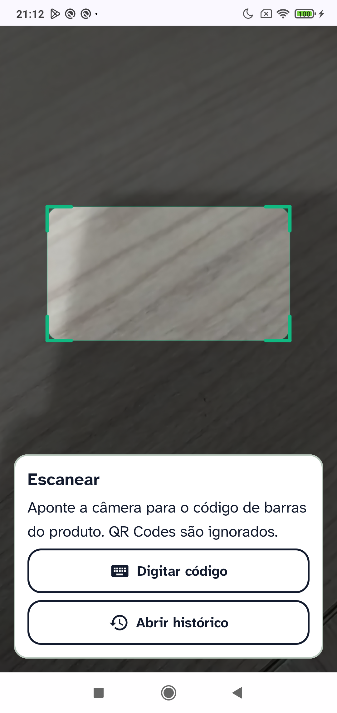
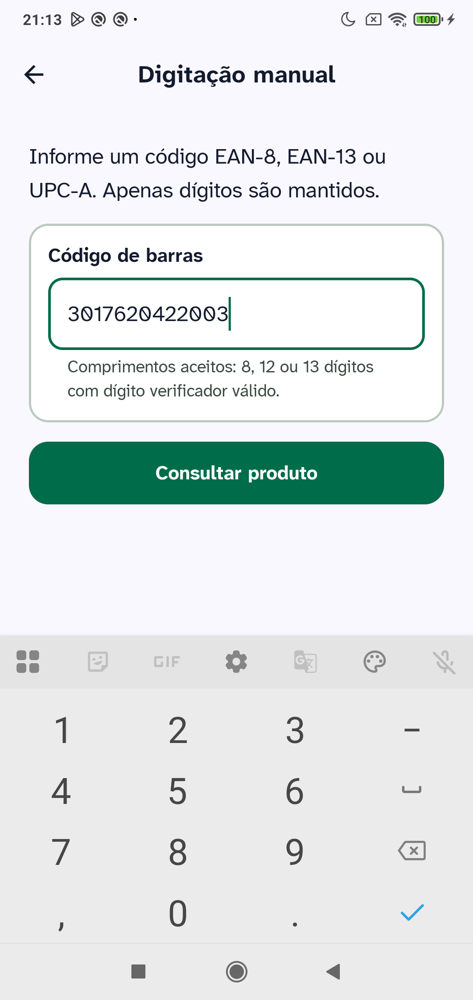
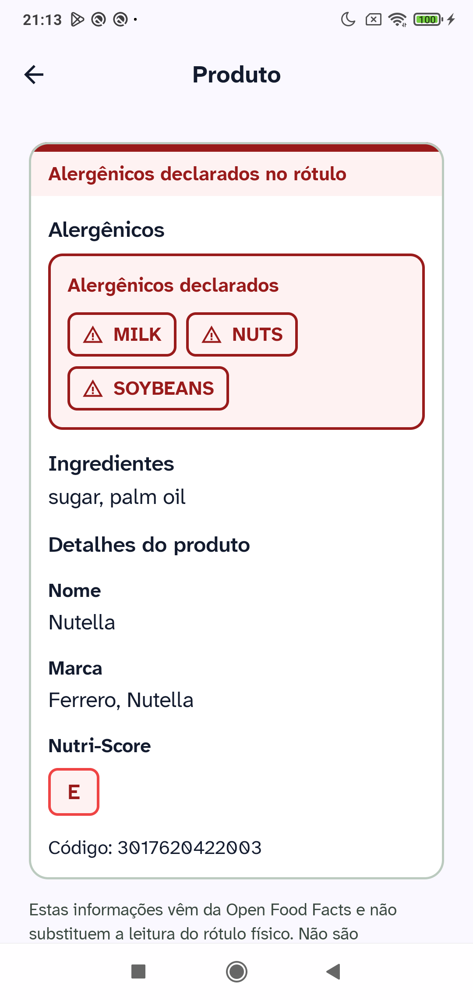
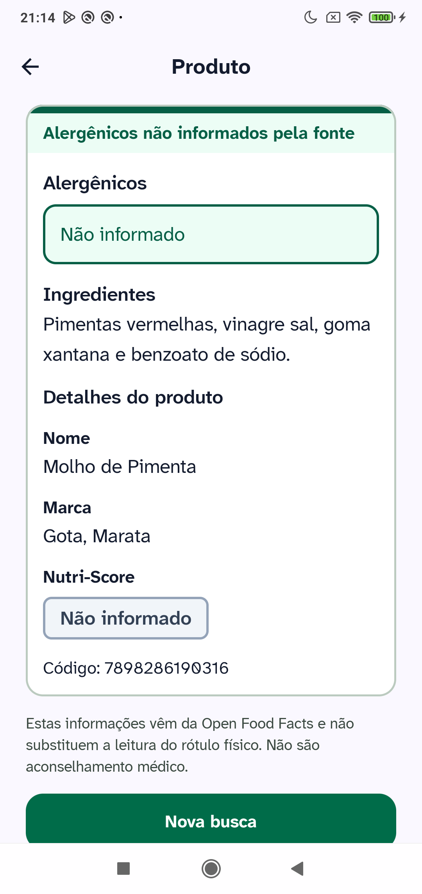
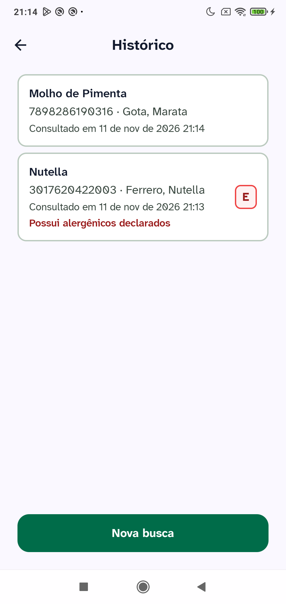

# AlertaRótulo

Aplicativo Android para consulta rápida de rótulos alimentares. Lê o código de barras **no aparelho**, busca o produto na [Open Food Facts](https://world.openfoodfacts.org/) e prioriza o que mais importa na decisão de compra: **alergênicos**, ingredientes e Nutri-Score.

A interface foi desenhada com tipografia legível, contraste reforçado e suporte a TalkBack. Não há conta, não há backend próprio e a imagem do código **nunca** sai do dispositivo — a rede é usada apenas para obter os dados do produto.

---

## Demonstração

<p align="center">
  
  &nbsp;
  
  &nbsp;
  
  &nbsp;
  
  &nbsp;
  
</p>

| Fluxo | O que a tela mostra |
|---|---|
| **Escanear** | Preview da câmera com mira, digitação manual e acesso ao histórico |
| **Digitação manual** | Validação de EAN-8, EAN-13 e UPC-A com dígito verificador |
| **Resultado** | Alergênicos em destaque, ingredientes, detalhes e Nutri-Score |
| **Dados parciais** | Campos ausentes na base como “Não informado”, sem parecer falha do app |
| **Histórico** | Consultas salvas no aparelho, reabríveis offline |

---

## Funcionalidades

- Leitura de código de barras on-device (CameraX + ML Kit) ou entrada manual
- Consulta à Open Food Facts com User-Agent conforme a política da API
- Hierarquia de resultado centrada em alergênicos → ingredientes → demais dados
- Estados distintos para produto não encontrado, falha de rede e permissão de câmera negada
- Histórico das últimas 20 consultas no aparelho, reabrível sem rede
- Interface em **português (Brasil)** e **inglês**, conforme o idioma do sistema
- Tema Material 3 com tipografia Atkinson Hyperlegible Next e badges semânticos

---

## Stack

| Camada | Tecnologias |
|---|---|
| Linguagem / UI | Kotlin, Jetpack Compose, Material 3 |
| Arquitetura | UI + Data, UDF/MVVM, Navigation 3, Hilt |
| Assíncrono | Coroutines, StateFlow, `collectAsStateWithLifecycle` |
| Rede | Retrofit, OkHttp, kotlinx.serialization |
| Persistência | Room (histórico local) |
| On-device | CameraX, ML Kit Barcode Scanning |

Decisões de pacotes, DI e integrações estão em [`docs/architecture.md`](docs/architecture.md).

---

## Arquitetura (visão geral)

```text
UI (Compose + Navigation 3 + ViewModels)
        │
        ▼
Repositories  ──►  Open Food Facts (remoto)
        │
        └──►  Room (histórico local)
```

- Single-Activity; ViewModels no nível de tela
- Repositories como única porta da data layer
- Pipeline de câmera/barcode no aparelho; só o código identificado segue para a consulta

---

## Acessibilidade

Acessibilidade faz parte do produto, não de um pós-processamento visual.

- Ordem de foco e conteúdo com alergênicos antes de blocos secundários
- Headings semânticos, `contentDescription` e `liveRegion` em estados críticos
- Alvos de toque generosos (≥ 52 dp) e layouts com scroll sob tipografia ampliada
- Informação nunca depende só de cor (texto + badges / Nutri-Score A–E)
- Histórico com descrição acessível unificada por item

Detalhamento do que está coberto e do que fica fora do escopo atual está nas specs de produto em [`docs/prd/alerta-rotulo.md`](docs/prd/alerta-rotulo.md).

---

## Como executar

**Requisitos:** Android Studio recente, JDK 11+, dispositivo ou emulador com **minSdk 26**.

```bash
./gradlew :app:assembleDebug
```

Abra o projeto no Android Studio, sincronize o Gradle e execute o módulo `:app`.

A câmera exige permissão em runtime; se for negada, o fluxo oferece digitação manual e atalho para as configurações do sistema.

---

## Documentação do projeto

| Documento | Conteúdo |
|---|---|
| [`docs/product-brief.md`](docs/product-brief.md) | Visão, escopo e critérios de sucesso |
| [`docs/prd/alerta-rotulo.md`](docs/prd/alerta-rotulo.md) | Comportamento por tela, fluxos e critérios de aceite |
| [`docs/architecture.md`](docs/architecture.md) | Camadas, stack, pacotes e integrações |
| [`docs/design/style-reference.md`](docs/design/style-reference.md) | Referência visual (orientação para UI) |

---

## Privacidade e dados

- Sem autenticação e sem servidor próprio
- Histórico permanece apenas no aparelho
- A imagem do código de barras não é enviada à nuvem
- Dados de produto vêm da Open Food Facts (ODbL); o cliente identifica-se via User-Agent (nome do app + contato), conforme a política deles

---

## Branches

| Branch | Uso |
|---|---|
| `main` | Linha estável |
| `develop` | Integração contínua do desenvolvimento |
